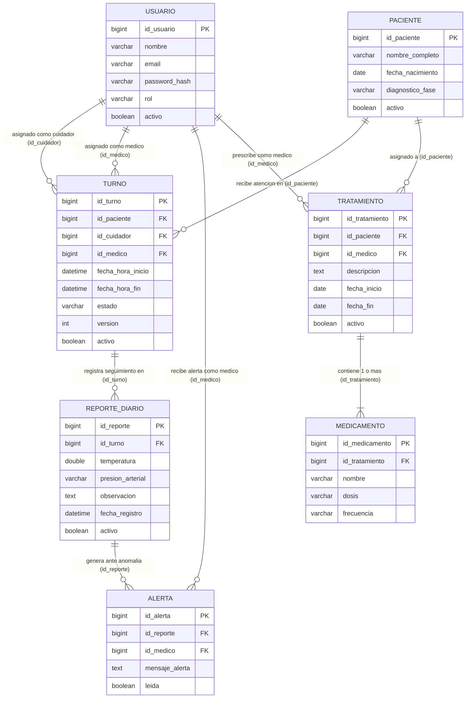

# Decisiones del Modelo Funcional de Lúmina

## 1. Propósito y Alcance

Este documento formaliza y describe el **modelo funcional acordado** para el backend del proyecto **Lúmina**, reflejando las decisiones tomadas por el responsable del proyecto respecto a:
1. La vinculación del **reporte diario** con el **turno**.
2. La relación de los **tratamientos** con sus **medicamentos** asociados.
3. El aplazamiento de las **notificaciones push** para una etapa posterior.

El objetivo es establecer criterios compartidos para todo el equipo de desarrollo, proporcionando una referencia clara y actualizada que **diferencie de forma explícita lo que ya se encuentra implementado en el código base (`main`) de lo que ha sido acordado pero permanece pendiente de desarrollo**.

---

## 2. Relevamiento y Comparación con la Documentación Original

Al contrastar la arquitectura inicial y los diagramas preliminares con el estado del código actual y las definiciones del responsable del proyecto, se identifican tres aspectos fundamentales:

| Área Funcional | Enfoque Inicial / Documentación Preliminar | Modelo Acordado y Ratificado |
|---|---|---|
| **Reportes Diarios** | En diagramas preliminares solía concebirse al reporte diario vinculado directamente al paciente o con doble asociación directa (paciente y cuidador). | **El reporte diario se asocia exclusivamente al turno (`Turno`)**. La relación con el paciente y el cuidador no se duplica en la tabla de reportes, sino que se obtiene a través del turno. |
| **Medicamentos** | Faltaba definir la granularidad de los tratamientos o se proyectaban estructuras con múltiples datos comerciales/farmacológicos. | **Cada tratamiento puede contener uno o varios medicamentos**. Los datos funcionales se restringen estrictamente a `nombre`, `dosis` y `frecuencia`. |
| **Notificaciones Push** | Se contemplaba preliminarmente el despacho push para alertar al médico ante desvíos clínicos. | **Quedan fuera del alcance de la etapa actual**. No se registran dispositivos móviles ni tokens de notificación. Las alertas se gestionan y consultan a través de la API REST. |

---

## 3. Decisiones Funcionales Confirmadas

### Decisión 1: El reporte diario se asocia a un turno
- Cada instancia de `ReporteDiario` pertenece a un único `Turno` a través de la clave foránea `id_turno`.
- **Navegabilidad:** El paciente asistido y el cuidador a cargo del reporte **se obtienen por transitividad** mediante el turno (`reporte.getTurno().getPaciente()` y `reporte.getTurno().getCuidador()`).
- **Justificación:** Esto asegura la trazabilidad operativa (un reporte ocurre en el contexto de una guardia/turno asignado), evita redundancias en la persistencia y previene inconsistencias (por ejemplo, registrar un reporte con un cuidador o paciente distinto al asignado en el turno).

### Decisión 2: Tratamiento con uno o varios medicamentos
- La relación funcional entre `Tratamiento` y `Medicamento` es de **uno a muchos (1 a N)**: un tratamiento puede estar compuesto por uno o más medicamentos prescritos.
- **Campos funcionales aprobados:** Para cada medicamento se acordó registrar **exclusivamente**:
  1. `nombre`: Identificación o nombre del fármaco/medicamento.
  2. `dosis`: Cantidad a suministrar (ej. "500 mg", "1 comprimido").
  3. `frecuencia`: Intervalo o periodicidad de administración (ej. "cada 8 horas", "1 vez al día con el desayuno").
- **Restricción de negocio:** No se añaden otros campos funcionales (como laboratorio, lote, fecha de vencimiento, forma farmacéutica o vía de administración).

### Decisión 3: Notificaciones push postergadas para una etapa posterior
- Se define explícitamente que la infraestructura y lógica para **notificaciones push quedan fuera del alcance actual**.
- **Elementos excluidos en esta fase:**
  - Tablas/entidades de registro de dispositivos móviles (IMEI, modelo, sistema operativo).
  - Almacenamiento y renovación de tokens de notificación (Firebase Cloud Messaging / APNs).
  - Lógica de despacho y clientes de mensajería push en el backend.
- **Comportamiento actual:** La entidad `Alerta` se persiste en la base de datos a partir de valores anómalos en los reportes diarios y es consultada por el profesional médico a través de endpoints REST (`GET /api/alertas/medico/{id}`).

---

## 4. Diagrama Entidad-Relación Acordado (Mermaid)

El siguiente diagrama representa el modelo funcional completo con las decisiones aprobadas. 

> **Nota:** La entidad `MEDICAMENTO` representa la decisión funcional acordada que será desarrollada en la tarea B-09.

---

## 5. Estado del Modelo: Implementado vs. Acordado Pendiente

Para evitar confusiones en los desarrollos subsecuentes, se clasifica rigurosamente el estado de cada componente del modelo funcional:

| Componente / Entidad | Estado Actual | Detalle y Referencia |
|---|---|---|
| **Usuario (`UsuarioEntity`)** | ✅ **Implementado** | Roles (`ADMIN`, `CUIDADOR`, `MEDICO`), borrado lógico y repositorios activos. |
| **Paciente (`PacienteEntity`)** | ✅ **Implementado** | Datos demográficos, fase diagnóstica, borrado lógico y DTOs operativos. |
| **Turno (`TurnoEntity`)** | ✅ **Implementado** | Vinculación entre paciente, cuidador y médico; control de concurrencia optimista (`@Version`). |
| **Reporte Diario (`ReporteDiarioEntity`)** | ✅ **Implementado** | Vinculado exclusivamente a `TurnoEntity` (`id_turno`). Cálculos y persistencia de temperatura, presión y observaciones. |
| **Alerta (`AlertaEntity`)** | ✅ **Implementado** | Vinculada a reporte y médico responsable. Consulta mediante REST implementada. |
| **Tratamiento (`TratamientoEntity`)** | ✅ **Implementado** | Asociación entre paciente y médico, fechas de inicio y fin, y descripción clínica. |
| **Medicamento (`MedicamentoEntity`)** | ⏳ **Acordado, Pendiente** | Modelo acordado (relación 1..* con tratamiento; campos `nombre`, `dosis`, `frecuencia`). **Su implementación corresponde a la tarea B-09**. No existe aún entidad en el código. |
| **Notificaciones Push** | 🛑 **Fuera de alcance** | Postergado para una etapa futura posterior. No existen tablas de dispositivos ni tokens en la arquitectura actual. |

---

## 6. Respuestas para el Pull Request

A continuación se fundamentan las respuestas requeridas para la integración de esta tarea:

### 1. ¿Por qué es importante diferenciar una decisión aprobada de una funcionalidad que ya está implementada?
Porque evita que otros integrantes del equipo asuman erróneamente que una funcionalidad o endpoint ya está disponible para ser consumido o testeado, lo que generaría bloqueos, errores en integraciones (por ejemplo, desde el frontend) y fallas de compilación. Documentar la diferencia permite que el equipo conozca el rumbo arquitectónico acordado sin generar expectativas falsas sobre el código actualmente presente en `main`.

### 2. ¿Qué relación tiene el reporte diario con el paciente y el cuidador bajo el modelo acordado?
Bajo el modelo funcional acordado, el reporte diario **no tiene una clave foránea directa con el paciente ni con el cuidador**. La relación es **indirecta a través del turno** (`id_turno`). Tanto el paciente como el cuidador se obtienen navegando la relación del turno correspondiente (`reporte.getTurno().getPaciente()` y `reporte.getTurno().getCuidador()`). Esto garantiza que el reporte diario solo se cargue en el contexto de una atención programada y validada.

### 3. ¿Qué problema puede causar que el diagrama de datos contradiga el código o las decisiones actuales?
Si el diagrama contradice el código o las decisiones:
- Se producen implementaciones dispares entre desarrolladores (por ejemplo, intentar relacionar reportes directamente con pacientes en nuevas APIs).
- Se distorsiona el diseño de la base de datos provocando migraciones innecesarias o inconsistencias en los modelos JPA.
- Se entorpece la comunicación entre los equipos de frontend y backend, ya que el frontend podría esperar campos o estructuras que no coinciden con las respuestas reales de la API.
