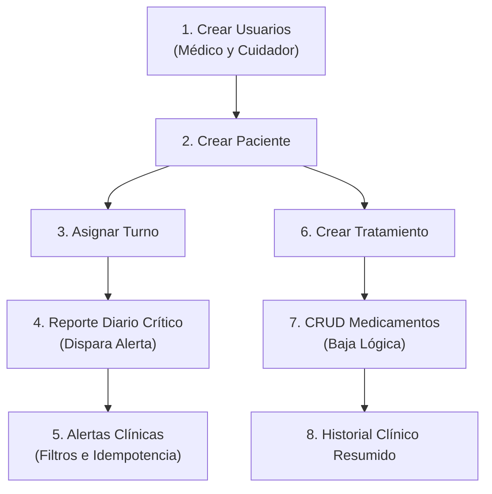

# 🏥 Guía de Pruebas de Integración de la API Lúmina (Postman)

Este documento describe el flujo completo paso a paso para probar e integrar todos los módulos desarrollados en el backend del **Proyecto Lúmina** mediante **Postman**.

---

## ⚙️ 1. Prerrequisitos de Ejecución

1. **Base de Datos MySQL:**
   * Debe estar corriendo en `localhost:3306`.
   * Base de datos: `bd_lumina`.
2. **Levantar la API (Spring Boot):**
   * Abrir una terminal en la carpeta `api-lumina`.
   * Ejecutar:
     ```powershell
     .\mvnw.cmd spring-boot:run
     ```
   * Confirmar que en consola aparezca: `Started ApiLuminaApplication on port 8080`.

> 💡 **Tip:** También se incluye en esta carpeta el archivo **`Lumina_API.postman_collection.json`**, el cual puedes importar directamente en Postman (*File -> Import*) para tener todas estas peticiones listas con un clic.

---

## 🔄 2. Flujo de Pruebas Secuencial

Para que todas las relaciones de base de datos funcionen coherentemente, sigue las peticiones en el orden indicado:



---

### 👤 Módulo 1: Usuarios y Roles (Issue #1)

#### 1.1 Registrar Médico
* **Método:** `POST`
* **URL:** `http://localhost:8080/api/usuarios`
* **Body:**
```json
{
  "nombre": "Dr. Gregory House",
  "email": "house@lumina.com",
  "password": "Password123!",
  "rol": "MEDICO"
}
```
* **Respuesta Esperada:** `201 Created` (ID generado: ej. `1`).

#### 1.2 Registrar Cuidador
* **Método:** `POST`
* **URL:** `http://localhost:8080/api/usuarios`
* **Body:**
```json
{
  "nombre": "Carlos Cuidador",
  "email": "carlos@lumina.com",
  "password": "Password123!",
  "rol": "CUIDADOR"
}
```
* **Respuesta Esperada:** `201 Created` (ID generado: ej. `2`).

#### 1.3 Validación de Email Duplicado (Control de Errores)
* **Método:** `POST`
* **URL:** `http://localhost:8080/api/usuarios`
* **Body:** Mismo JSON de `house@lumina.com`.
* **Respuesta Esperada:** `409 Conflict`.

---

### 🧑‍⚕️ Módulo 2: Pacientes

#### 2.1 Crear Paciente
* **Método:** `POST`
* **URL:** `http://localhost:8080/api/pacientes`
* **Body:**
```json
{
  "nombreCompleto": "Carlos Gómez",
  "fechaNacimiento": "1975-04-12",
  "diagnosticoFase": "Fase 1"
}
```
* **Respuesta Esperada:** `201 Created` (ID generado: ej. `1`).

---

### 📅 Módulo 3: Turnos Médicos (Issue #2)

#### 3.1 Asignar Turno Médico
* **Método:** `POST`
* **URL:** `http://localhost:8080/api/turnos`
* **Body:**
```json
{
  "idPaciente": 1,
  "idCuidador": 2,
  "idMedico": 1,
  "fechaHoraInicio": "2026-10-21T08:00:00",
  "fechaHoraFin": "2026-10-21T16:00:00"
}
```
* **Respuesta Esperada:** `201 Created` (ID de turno generado: ej. `1`).

---

### 📋 Módulo 4: Reportes Diarios con Disparo de Alertas (Issue #3 y #5)

#### 4.1 Registrar Reporte con Signos Críticos
* **Método:** `POST`
* **URL:** `http://localhost:8080/api/reportes-diarios`
* **Body:**
```json
{
  "idTurno": 1,
  "temperatura": 39.5,
  "presionArterial": "190/120",
  "observacion": "Fiebre alta persistente y presión arterial elevada."
}
```
* **Respuesta Esperada:** `201 Created`.
* **Efecto colateral automático:** Al superar los umbrales (Temp `>= 38.0°C` o Presión `>= 180/120`), el servicio crea automáticamente una alerta clínica asignada al médico del turno.

---

### 🚨 Módulo 5: Alertas Clínicas (Issue #16 / B-10)

#### 5.1 Consultar Alertas No Leídas (Comportamiento por Defecto)
* **Método:** `GET`
* **URL:** `http://localhost:8080/api/alertas/medico/1`
* **Respuesta Esperada:** `200 OK` con la alerta pendiente (`"leida": false`).

#### 5.2 Consultar con Filtro de Leídas
* **Método:** `GET`
* **URL:** `http://localhost:8080/api/alertas/medico/1?leida=true`
* **Respuesta Esperada:** `200 OK` con lista vacía `[]` (aún no se ha leído).

#### 5.3 Marcar Alerta como Leída
* **Método:** `PATCH`
* **URL:** `http://localhost:8080/api/alertas/medico/1/1/leida`
* **Body:** Ninguno.
* **Respuesta Esperada:** `200 OK` mostrando `"leida": true`.

#### 5.4 Prueba de Idempotencia
* **Método:** `PATCH`
* **URL:** `http://localhost:8080/api/alertas/medico/1/1/leida`
* Presionar **Send** nuevamente.
* **Respuesta Esperada:** `200 OK` (no lanza errores y no realiza escrituras redundantes).

#### 5.5 Prueba de Seguridad (IDOR / Alerta Ajena)
* **Método:** `PATCH`
* **URL:** `http://localhost:8080/api/alertas/medico/99/1/leida`
* **Respuesta Esperada:** `404 Not Found` (protege la existencia de alertas de otros médicos).

---

### 💊 Módulo 6: Tratamientos Médicos (Issue #4)

#### 6.1 Crear Tratamiento
* **Método:** `POST`
* **URL:** `http://localhost:8080/api/tratamientos`
* **Body:**
```json
{
  "idPaciente": 1,
  "idMedico": 1,
  "descripcion": "Tratamiento de control de hipertensión y cuadro febril",
  "fechaInicio": "2026-10-20",
  "fechaFin": "2026-11-20"
}
```
* **Respuesta Esperada:** `201 Created` (ID generado: ej. `1`).

---

### 🧪 Módulo 7: Medicamentos y Baja Lógica (Issue B-09)

#### 7.1 Prescribir Medicamento 1
* **Método:** `POST`
* **URL:** `http://localhost:8080/api/medicamentos`
* **Body:**
```json
{
  "idTratamiento": 1,
  "nombre": "Amoxicilina",
  "dosis": "500 mg",
  "frecuencia": "Cada 8 horas"
}
```
* **Respuesta Esperada:** `201 Created` (ID generado: `1`, `"activo": true`).

#### 7.2 Prescribir Medicamento 2
* **Método:** `POST`
* **URL:** `http://localhost:8080/api/medicamentos`
* **Body:**
```json
{
  "idTratamiento": 1,
  "nombre": "Paracetamol",
  "dosis": "1 g",
  "frecuencia": "Cada 8 horas en caso de fiebre"
}
```
* **Respuesta Esperada:** `201 Created` (ID generado: `2`).

#### 7.3 Consultar Medicamentos del Tratamiento
* **Método:** `GET`
* **URL:** `http://localhost:8080/api/medicamentos/tratamiento/1`
* **Respuesta Esperada:** `200 OK` devolviendo la lista de medicamentos prescritos.

#### 7.4 Probar Baja Lógica (Soft Delete)
* **Método:** `DELETE`
* **URL:** `http://localhost:8080/api/medicamentos/2`
* **Respuesta Esperada:** `204 No Content`.
* *(Verificación)*: Consultar `GET http://localhost:8080/api/medicamentos/2` responderá `404 Not Found` (mantiene el registro en BD con `activo = false`).

---

### 📂 Módulo 8: Historial Clínico Resumido (Issue #6)

#### 8.1 Consultar Resumen Clínico Integral
* **Método:** `GET`
* **URL:** `http://localhost:8080/api/pacientes/1/historial`
* **Respuesta Esperada:** `200 OK` devolviendo un objeto unificado que integra:
  * Datos del **Paciente**.
  * **Usuarios relacionados** (médico y cuidador asignados).
  * Lista de **Turnos** previos y agendados.
  * Lista de **Tratamientos** vigentes.

---

### 🚨 Módulo 9: Incidentes y Observaciones Extraordinarias (Issue #43 - B-32)

#### 9.1 Registrar Incidente con Severidad ALTA (Dispara Alerta)
* **Método:** `POST`
* **URL:** `http://localhost:8080/api/reportes-diarios/1/incidentes`
* **Body:**
```json
{
  "tipoIncidente": "CAIDA",
  "descripcion": "Paciente tropezó al levantarse de la cama y sufrió una caída con golpe leve.",
  "severidad": "ALTA"
}
```
* **Respuesta Esperada:** `201 Created` con `alertaGenerada: true`. Se genera una alerta clínica en la bandeja del médico del turno.

#### 9.2 Registrar Incidente con Severidad LEVE (Sin Alerta)
* **Método:** `POST`
* **URL:** `http://localhost:8080/api/reportes-diarios/1/incidentes`
* **Body:**
```json
{
  "tipoIncidente": "DESORIENTACION",
  "descripcion": "Paciente presentó leve desorientación temporal luego de la siesta.",
  "severidad": "LEVE"
}
```
* **Respuesta Esperada:** `201 Created` con `alertaGenerada: false`.

#### 9.3 Listar Incidentes del Reporte
* **Método:** `GET`
* **URL:** `http://localhost:8080/api/reportes-diarios/1/incidentes`
* **Respuesta Esperada:** `200 OK` con la lista cronológica de incidentes asociados al reporte.

#### 9.4 Verificar Alerta en la Bandeja del Médico
* **Método:** `GET`
* **URL:** `http://localhost:8080/api/alertas/medico/1`
* **Respuesta Esperada:** `200 OK` conteniendo la nueva alerta de incidente severo disparada automáticamente.

---

## 📊 3. Resumen de Códigos HTTP Implementados

| Código | Significado | Ejemplos de uso |
| :--- | :--- | :--- |
| **`200 OK`** | Consulta o modificación exitosa | `GET /alertas`, `PATCH /leida`, `GET /historial` |
| **`201 Created`** | Recurso creado exitosamente | `POST /usuarios`, `POST /tratamientos`, `POST /medicamentos` |
| **`204 No Content`** | Eliminación / Baja lógica exitosa | `DELETE /medicamentos/{id}`, `DELETE /tratamientos/{id}` |
| **`400 Bad Request`** | Datos inválidos o faltantes | Rol inexistente, fechas de tratamiento inconsistentes |
| **`404 Not Found`** | Recurso no encontrado o no asignado | Alerta/Medicamento inexistente o perteneciente a otro médico |
| **`409 Conflict`** | Conflicto de unicidad | Intento de registrar un email ya existente en la base |
